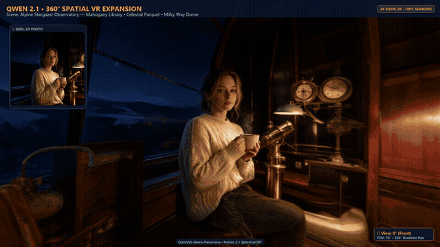

# 🌐 ComfyUI-Qwen-Panorama

Transform any single 2D photo into a seamless **360° Equirectangular VR Panorama** using **Qwen-Image 2.1** in ComfyUI. Includes an in-canvas interactive WebGL 360° VR viewer, Google Photo Sphere XMP injection, and dual execution modes (Turbo ~20s vs. Full Quality 2K).

Tested and optimized for **8GB VRAM GPUs** (RTX 4070 Laptop) — stays strictly under **7.0 GB peak VRAM**.

<p align="center">
  <a href="docs/showcase_16x9.mp4">
    
  </a>
  <br>
  <em>🌐 Spatial expansion demo (2D portrait seed input &rarr; seamless 360° VR world). <b>Click image to open full 1080p video</b>.</em>
</p>

---

## ✨ Features

- **2D Photo to 360° World**: Feed in a single normal photo (placed in center foreground); the model synthetically invents the rest of the 360° world (sky above, ground below, behind you) matching exact lighting and atmosphere.
- **In-Canvas Interactive 360° VR Viewer**:
  - Hardware-accelerated pure WebGL equirectangular shader (0 KB external libraries).
  - Smooth drag-to-look (yaw/pitch) with zero gimbal lock.
  - Mouse-wheel FOV zoom (40° to 120°).
  - 1-click Fullscreen VR preview.
- **Strict 2:1 Native Aspect Ratio**: Generates at `1472×736` (1.08 MP, exact 2:1, multiple of 32) ensuring spherical geometric accuracy and 100% VRAM residency without PCIe weight offloading.
- **Instant Seamless 2K VR Upscaling**: `QwenPanoramaUpscale` with circular seam-wrapping (`seamless_boundary: true`) upgrades 1472×736 to crisp 2048×1024 2K VR in < 1 second.
- **Dual Pipeline Support**:
  - **⚡ Fast Turbo Mode (~25–35s)**: 6 steps via Viggle Turbo LoRA & custom fast sigmas.
  - **💎 Full Quality Mode (< 2 min)**: 25 steps via native Euler sampler for pristine 2K VR skyboxes.
- **Smart 360 Export**:
  - Standard Equirectangular PNG / WebP.
  - Automatic **Google Photo Sphere XMP metadata injection** into JPEG so Facebook, Google Photos, and VR headsets auto-detect and render it as an interactive 360 sphere.
  - Optional rotating 360° horizontal flythrough MP4 video encoded via FFmpeg.

---

## 📦 Installation

```bash
cd ComfyUI/custom_nodes
git clone https://github.com/ehab-ayman-gharib/ComfyUI-Qwen-Image-2.1-Panorama.git
pip install -r ComfyUI-Qwen-Image-2.1-Panorama/requirements.txt
```

Restart ComfyUI.

---

## 📥 Required Models

| Role | File Name | Size | Storage Directory | Download Link |
| :--- | :--- | :--- | :--- | :--- |
| **Diffusion (DiT)** | `qwen_image_2.1_Q5_K_M.gguf` | 5.8 GB | `models/unet/` | [Hugging Face](https://huggingface.co/AlperKTS/Qwen-Image-2.1-GGUF) |
| **360 Pano LoRA** | `pano360_qwen21_edit_v1.safetensors` | 152 MB | `models/loras/` | [Hugging Face](https://huggingface.co/Gogodr/qwen-image-2.1-edit-pano360-lora) |
| **Turbo LoRA** *(Optional)* | `Qwen-Image-2.1-viggle-turbo-v0.2.1-6step-lora-r128.safetensors` | 315 MB | `models/loras/` | [Hugging Face](https://huggingface.co/ViggleAI/Qwen-Image-2.1-viggle-turbo) |
| **Text Encoder** | `qwen3vl_8b_w4a8.safetensors` | 5.8 GB | `models/text_encoders/` | [Hugging Face](https://huggingface.co/Comfy-Org/Qwen-Image-2.1) |
| **VAE** | `qwen_image_2.1_vae_bf16.safetensors` | 496 MB | `models/vae/` | [Hugging Face](https://huggingface.co/Comfy-Org/Qwen-Image-2.1) |

---

## 🚀 Workflows Included

Both ready-to-run workflow JSON files are located in `workflows/`:
1. `Qwen_Image_2.1_Viggle_Turbo_Panorama_360.json`: 6-step fast draft (~20s generation on 8GB VRAM).
2. `Qwen_Image_2.1_Full_Quality_Panorama_360.json`: 25-step production 2K render (`2048×1024`).

Simply drag and drop either JSON file directly into your ComfyUI window!

---

## 🧩 Custom Nodes Reference

All custom nodes are categorized under `QwenPanorama`:

| Node Name | Category | Primary Function | Key Parameters |
| :--- | :--- | :--- | :--- |
| **Qwen 360 Panorama Prompt** | `QwenPanorama` | Constructs formatted 360° trigger prompts with lighting and scene environment modifiers. | `scene_description`, `lighting`, `environment_type` |
| **Qwen 360 Panorama Latent (2:1)** | `QwenPanorama` | Generates 64-channel empty latents snapped to exact 2:1 spherical dimensions (multiples of 64). | `resolution_preset`, `custom_width`, `batch_size` |
| **Qwen 360 VR Panorama Viewer** | `QwenPanorama` | Interactive WebGL in-canvas 360° viewer with yaw/pitch dragging and FOV zoom. | `images`, `default_fov`, `auto_rotate` |
| **Qwen 360 Panorama Export** | `QwenPanorama` | Exports with Google Photo Sphere XMP metadata and optional rotating MP4 flythrough video. | `format`, `export_rotating_video`, `video_duration_seconds` |
| **Qwen 360 Panorama Upscale (2K/4K)** | `QwenPanorama` | Seamless 2:1 upscaler with 5% toroidal boundary wrapping to prevent vertical seam artifacts. | `target_resolution`, `seamless_boundary`, `upscale_method` |
| **Qwen 360 Panorama Seam Extract (Step 1)** | `QwenPanorama` | Rolls by 50% to place seam at center and crops narrow vertical strip for fast inpainting. | `image`, `crop_width` (default: 512px) |
| **Qwen 360 Panorama Seam Restore (Step 2)** | `QwenPanorama` | Blends healed crop back using cosine feathered alpha masking and unrolls to original orientation. | `healed_crop`, `seam_context`, `feather_width` |
| **Qwen 360 Panorama Horizontal Roll** | `QwenPanorama` | Horizontally shifts equirectangular image and synced mask along the cylindrical axis. | `mode` (Roll 50% / Unroll / Custom), `mask` |
| **Qwen 360 Panorama Seam Router (2-Phase)** | `QwenPanorama` | Automatically routes between centering/saving to `input/` (Phase 1) and inpainting (Phase 2). | `image`, `mask`, `mode` |

---

## 🤝 Credits & Acknowledgments

- **Gogodr**: Author of [360 Panorama Maker for Qwen-Image 2.1 Edit](https://civitai.com/models/2976898/360-panorama-maker-qwen-image-21-edit) and Poly Haven dataset curation.
- **Qwen Team (Alibaba)**: [Qwen-Image 2.1](https://github.com/QwenLM/Qwen-Image) foundation model.
- **Poly Haven**: CC0 HDRIs and panoramic training environments.

---

## 📄 License

This repository is licensed under the **Apache License 2.0**.
